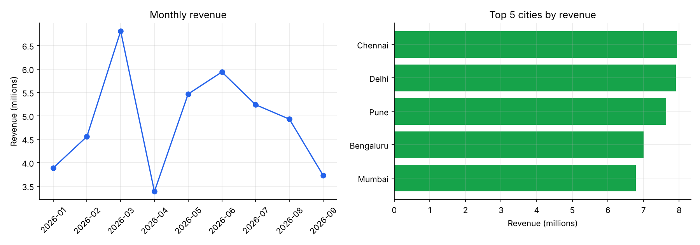
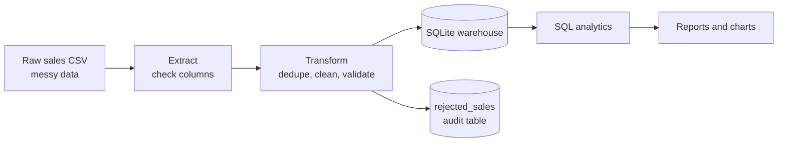

# Sales ETL Pipeline

[](https://github.com/Manishjangir01/sales-etl-pipeline/actions/workflows/tests.yml)


A small, end-to-end **data engineering** project: it takes a messy raw sales CSV, cleans and validates it, loads it into a SQLite warehouse, and answers business questions with SQL.



*Charts are generated from the warehouse by `src/plot_report.py`. The data is synthetic.*

## Pipeline



| Stage | What it does |
|-------|--------------|
| Extract | Reads the CSV and checks that all required columns exist |
| Transform | Drops duplicate orders, parses dates, normalises city names, rejects invalid rows (missing city, bad date, quantity <= 0), adds `revenue` and `order_month` |
| Load | Writes `fact_sales` and a `rejected_sales` audit table to SQLite, with indexes |
| Analytics | Monthly revenue, top cities, best-selling products, top customers |

## Sample results

From a run on 1,020 raw rows: 20 duplicates removed, 49 invalid rows rejected, **951 clean rows** loaded.

| City | Revenue |
|------|---------|
| Chennai | 7,943,700 |
| Delhi | 7,911,900 |
| Pune | 7,638,000 |
| Bengaluru | 7,001,200 |
| Mumbai | 6,788,400 |

Best-selling product by units: **Mouse** (548 units). Highest revenue product: **Laptop** (25,520,000).

## Project structure

```
src/generate_data.py   # creates a synthetic raw dataset with injected data-quality issues
src/etl.py             # extract / transform / load
src/report.py          # runs sql/analytics.sql against the warehouse
src/plot_report.py     # draws the charts in docs/
sql/analytics.sql      # business queries
tests/test_etl.py      # unit + end-to-end tests
.github/workflows/     # runs the tests on every push
```

## Run it

```bash
pip install -r requirements.txt
python src/generate_data.py --rows 1000
python src/etl.py
python src/report.py
python src/plot_report.py
pytest
```

## Skills demonstrated

- ETL design with separate extract, transform and load steps
- Data quality handling: deduplication, validation, and a rejected-rows audit table
- Python (pandas), SQL (aggregations, indexes), SQLite
- Logging, CLI arguments, automated tests and CI with GitHub Actions

## Ideas for next steps

- Orchestrate with Airflow or cron
- Swap SQLite for PostgreSQL
- Add incremental loads and data-quality reporting

## License

MIT, see [LICENSE](LICENSE).
